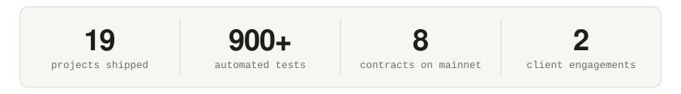

<picture>
  <source media="(prefers-color-scheme: dark)" srcset="./assets/header-dark.svg">
  <source media="(prefers-color-scheme: light)" srcset="./assets/header-light.svg">
  
</picture>

### 01 &nbsp;·&nbsp; About

I design, test and ship smart contracts in Solidity, then build the indexers, APIs and interfaces around them.

What I care about is the whole path a transaction takes: the contract that holds the money, the tests that prove it can't be drained, the indexer that makes it queryable, and the interface someone actually clicks.

- Started building on-chain in 2024 at hackathons, leading small teams on HelpChain and CleanChain
- Three Web3 internships, co-led the GENESIS Web3 community, and paid client work since
- Computer Engineering student, open to **part-time, contract and freelance** work (IST, UTC+5:30)

<picture>
  <source media="(prefers-color-scheme: dark)" srcset="./assets/stats-dark.svg">
  <source media="(prefers-color-scheme: light)" srcset="./assets/stats-light.svg">
  
</picture>

### 02 &nbsp;·&nbsp; What I do

**Smart contracts & protocols** &nbsp;—&nbsp; AMMs, bonding curves, batch auctions, vaults, vesting and staking, written in Solidity and structured for upgrades with UUPS proxies and timelocks.

**Security-first engineering** &nbsp;—&nbsp; unit, fuzz and invariant suites in Foundry, reproduced exploits paired with their defenses, and careful fixed-point math.

**Full-stack products** &nbsp;—&nbsp; event indexers, APIs and real-time backends (Node, Postgres, Redis), plus Next.js and React interfaces, shipped to production with monitoring.

### 03 &nbsp;·&nbsp; Stack

<table>
<tr><td><b>Smart contracts</b></td><td>    </td></tr>
<tr><td><b>Protocols</b></td><td>    </td></tr>
<tr><td><b>Frontend</b></td><td>      </td></tr>
<tr><td><b>Backend & data</b></td><td>      </td></tr>
<tr><td><b>Chains</b></td><td>    </td></tr>
</table>

### 04 &nbsp;·&nbsp; Client work

**[Memeko](https://www.memeko.fun)** &nbsp;—&nbsp; fair-launch token launchpad, live on Kinetiq Elysium mainnet `ongoing` 
Each token trades on its own bonding curve, then graduates into a Uniswap V2 pool seeded at the exact final curve price, with the LP burned. I built it end to end: 6 core contracts behind UUPS proxies and a 2-day timelock, a custom event indexer for candles and PnL, and the Next.js trading app. 
8 verified contracts &nbsp;·&nbsp; ~170 Foundry tests &nbsp;·&nbsp; curve math wei-exact on 512 vectors &nbsp;·&nbsp; 0% price shock at graduation &nbsp;·&nbsp; [app](https://www.memeko.fun) &nbsp;·&nbsp; [testnet](https://testnet.memeko.fun)

**[Vimal Impex](https://vimalimpex.com)** &nbsp;—&nbsp; company website and product catalogue for a metals manufacturer `delivered` 
Designed, built and deployed an 11-route site with a 6-family catalogue and quote requests routed to WhatsApp and email. 
React &nbsp;·&nbsp; Tailwind CSS &nbsp;·&nbsp; Vite &nbsp;·&nbsp; Cloudflare

### 05 &nbsp;·&nbsp; Selected projects

**[ClearSwap](https://github.com/Jash-Bohare/ClearSwap)** &nbsp;—&nbsp; MEV-resistant DEX 
Collects limit orders into 45-second batch auctions that clear at one uniform price, so transaction ordering stops mattering. 
1st place, Arbitrum Builder Pods 2026 &nbsp;·&nbsp; 82.5% less gas &nbsp;·&nbsp; verified on Arbitrum Sepolia &nbsp;·&nbsp; [live demo](https://clearswap-dex.pages.dev) &nbsp;·&nbsp; [code](https://github.com/Jash-Bohare/ClearSwap)

**[Zapline](https://github.com/Jash-Bohare/Zapline)** &nbsp;—&nbsp; Uniswap V2 integration suite and security lab 
A router, single-sided zaps, a TWAP oracle, an ERC-4626 LP vault and flash-swap arbitrage, next to a lab that exploits naive versions of each pattern and shows the defense holding up. 
7 verified contracts on Base Sepolia &nbsp;·&nbsp; 4 exploits reproduced and fixed &nbsp;·&nbsp; 109 tests across 12 suites &nbsp;·&nbsp; [contracts](https://sepolia.basescan.org/address/0x3b9822F6a5a85b02A484946466E4c10AE8DdB46b#code) &nbsp;·&nbsp; [code](https://github.com/Jash-Bohare/Zapline)

**[AstraVault](https://github.com/Jash-Bohare/AstraVault)** &nbsp;—&nbsp; non-custodial Ethereum wallet 
Implements the key-management path directly: mnemonic generation, HD derivation, encrypted storage at rest and session-only decrypted keys. 
BIP-39 / BIP-32 / BIP-44 &nbsp;·&nbsp; AES-256-GCM + PBKDF2 (310k iterations) &nbsp;·&nbsp; EIP-1559 and EIP-191 signing &nbsp;·&nbsp; [live demo](https://astravault-wallet.pages.dev) &nbsp;·&nbsp; [code](https://github.com/Jash-Bohare/AstraVault)

**[ChronoVest](https://github.com/Jash-Bohare/ChronoVest)** &nbsp;—&nbsp; vesting protocol 
Each vesting grant is an ERC-721, so owning the NFT means owning the remaining tokens. Recipients self-claim from a single Merkle root. 
256 claim flags per storage slot &nbsp;·&nbsp; 32 tests, 95%+ line coverage &nbsp;·&nbsp; [contract](https://sepolia.etherscan.io/address/0xCf56d415D4Be6E8c822b4eb332854d0296eeC134#code) &nbsp;·&nbsp; [code](https://github.com/Jash-Bohare/ChronoVest)

**[Axiom](https://github.com/Jash-Bohare/Axiom)** &nbsp;—&nbsp; staking protocol 
Synthetix-style O(1) reward-per-token accumulator, an emergency pause that never traps funds, and exits that always stay open. 
3 contracts &nbsp;·&nbsp; 100% core coverage &nbsp;·&nbsp; [contract](https://sepolia.etherscan.io/address/0x1068167479A587D2E95EF795b936Ca33c74a8f81#code) &nbsp;·&nbsp; [code](https://github.com/Jash-Bohare/Axiom)

All 19 projects, with architecture diagrams and deployed contracts: [jashbohare.dev/projects](https://jashbohare.dev/projects)

### 06 &nbsp;·&nbsp; Experience

| Role | Where | When |
| :-- | :-- | :-- |
| Smart Contract & Full-Stack Developer (freelance) | Memeko | Sep 2026 – present |
| Blockchain Developer Intern | Calip.io | May – Aug 2026 |
| Developer Relations Intern | TriKaya | Dec 2025 – Jan 2026 |
| Blockchain Developer Intern | PedalsUp | Sep – Oct 2025 |
| Co-Head | GENESIS Web3 Community | Jun 2025 – Jan 2026 |

### 07 &nbsp;·&nbsp; Hackathons

**1st place** &nbsp;·&nbsp; Arbitrum Builder Pods 2026 &nbsp;—&nbsp; [ClearSwap](https://github.com/Jash-Bohare/ClearSwap), batch-auction DEX 
**3rd place, Stellar track** &nbsp;·&nbsp; HackHazards 2025 &nbsp;—&nbsp; [HelpChain](https://github.com/Jash-Bohare/HelpChain), transparent NGO donations (54 teams; Top 100 of 791 globally)

### 08 &nbsp;·&nbsp; Connect

     
